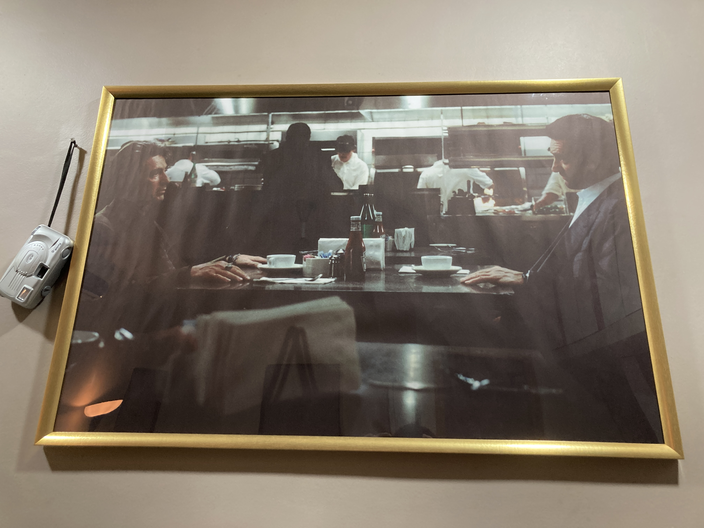
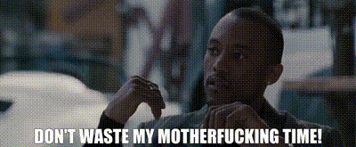

I've hung a big-ass, gold-framed print of the diner scene in our living room. My side-quest in life is to reopen [Kate Mantilini](https://en.wikipedia.org/wiki/Kate_Mantilini). I've watched our mutually-agreed-upon greatest film of all time at least 15 times. 

So you know my word counts, brother. 

Us fans have one thing in common: we're going to walk out on everything in 30 seconds flat when we spot Heat 2 at the box office. But when it comes to the book, we're divided into three archetypes:

1. "I'll watch the film first, then read the book." 
2. "I'll read the book, then watch the film."
3. "I'm not much of a reader, so I don't care about the book." 

Most are the first type -- they want to watch the film first, then read the book, that is if they ever get around to it. And I get that. On paper it makes perfect sense: Heat is a film. Michael Mann's primary medium is film. So as a fan you're thinking, "When the film comes out, I want to go into the theater fresh, without any prior information, without any spoilers, because I want to experience Heat 2 just as Michael Mann intended. That's why I don't want to read the book first." 

But the reality is, in fact, the opposite. Reading the book, that too before you watch the film, is the only possible way to experience Heat 2 just as Michael Mann intended. Let me explain. 
## An uncorrupted experience with the original cast
If Michael Mann had a magic wand that could make Pacino, De Niro, Kilmer (RIP) and the others 1995-young again to film Heat 2, I bet he'd wave it faster than you could say 'Slick.' I bet he'd give anything to have the original cast in Heat 2. So would you. So would I. Fuck, I'd let Albert waste my motherfuckin' *life* if that meant I could watch Heat 2 with the original cast. 

But the thing is, I already did. No, not let Albert waste my motherfuckin' life, but watch Heat 2 with the original cast. How? By reading the book. No wait, don't roll your eyes. You're probably thinking "But Jackie, reading books and watching films are two totally different things. How can you compare them?" And normally, I'd agree with you, but not on this one, because this book is rare. I'll tell you why in just a bit, but the point is, you can experience Heat 2 with the original cast. All you have to do is read the book. 

But there's a catch: you'll need to read it *before* you watch the film. If you try to read it after, you'll have the faces of the new cast interfering in your mind as you imagine the characters and events of the book.

That's why I think reading the book before before watching the film is the only possible way to experience Heat 2 like it was meant to be: with the same Neil, Hanna, Vincent and others in their uncorrupted glory, without anyone else taking their place. That's how I experienced it, and it was pure and special. 

Now let me tell you exactly what it is that makes this book feel like you're watching a film and why it's rare.
## A real novel, not a pitch novel 
I'll be able to better convey this to you l if I establish some context first, so please bear with me for a couple of paragraphs as I tell you about my experience with a different book. 

A few months ago, I read a few pages from the book version of 'Once Upon a Time in Hollywood'. Its cover said it was a novel, but I noticed something weird. The paragraphs followed a pattern that went like this: 

He said, "*some dialogue*".  He did *some action*. *Something* happened. 

She said, "*some dialogue*".  She did *some action*. *Something* happened.

Novels don't read like that. I realized it was actually the film screenplay (or script) published as-is, without any effort put in to adapt it to the crime novel format. I didn't bother reading further.

The reverse happens too. Sometimes authors write "novels" with the sole intention of turning them into films later, so they write them more like screenplays and less like novels, hoping to catch the attention of studio execs. The problem is, novels and screenplays are fundamentally at odds with each other in how they tell stories. Internal monologue is the bread and butter of a novel. But the number one rule of cinema is show, don't tell. So these authors (over-)rely on spoken dialogue and detailed physical action to tell the story, completely forgetting about internal monologue, and the reader is never able to get into the heads of the characters, feel what they're feeling, connect with their emotions, connect with their reality and truly experience it. Due to this lack of internal monologue and other novelistic craft, the reading experience of such fake "novels" is always subpar. I've unfortunately read a couple of such fake novels and I hated them. 

But Heat 2 is not a fake novel. Our dear Michael Mann has gone the extra mile and collaborated with a real crime fiction author to write Heat 2 like it was a real crime novel, not just some Hollywood "pitch novel" meant to attract producers. 

But it's not just a crime novel either. It combines novelistic craft with the detailed action of a movie screenplay, so I was able to experience it both as a book and as a film. I could create the set in my head, watch the action, play the scenes (with the original cast, by the way) like it were a film, *and* get into the heads of Neil, Hanna, Chris and the other characters, feel what they were feeling, connect with them emotionally, and have the satisfaction of having read a good crime novel. It was beautiful. It was a treat for the senses. You don't usually find such experiences.

This is what you get when a director and a novelist combine their crafts. Michael Mann and Meg Gardiner have done justice to the crime novel format and their readers. 

 Initially, I'd been scared to read this book because you know how it goes with much-awaited sequels - sometimes they turn out to be shit (looking at you, [Cursed Book](https://www.goodreads.com/en/book/show/29056083-harry-potter-and-the-cursed-child)). But not this one. 'Heat 2' is a heavy title that comes with a lot of expectations, and I'm happy to say this sequel has earned it.

Let me conclude with one more argument for how reading Heat 2 before watching it can improve your experience of the film.
## Don't judge the film for something it was never meant to do 
The film doesn't deserve to be judged for something we all know it can never do: It cannot hit the same without the original cast. But if you read the book, you will already have enjoyed it with the original cast, so you'll go into the theater knowing this and enjoy it for what it is, without any subconscious biases toward or longing for the original cast clouding your judgment of the story. Because it is one hell of a good story. 

Don't get me wrong, I'm not saying it's impossible for Heat 2 to meet our expectations. No, I actually believe the opposite: I'm fully confident it will hold its own. But no matter what Michael Mann does or how well the new cast do their jobs, something big is going to be missing: the original cast. Our job as the audience is to go in knowing this and not hold it against the film.

Because the original cast was special and no one can take their place. The original Neil, Hanna and Chris were special. The original cinematography, color palette and look were special. 1995 was special. The feel of the time was special. And you can have all of that original goodness in this new story. If you want. Have Heat 2 look and feel just as good as the Heat you've always loved, with the same cast that you've always loved. Have both fuse into one story, one film, continuous, flowing, like it hasn't been three decades, like it was never really over. One cohesive masterpiece.

<!-- site-writer content: 1e74c93fce274e5fe4fd5be6b696a8d014e2a1307d1ce4a9d1f5301efbd5e76d -->
